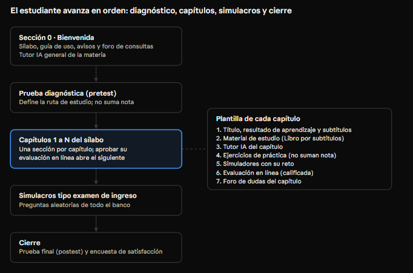

# Guía para crear las aulas virtuales en Moodle – Proyecto CE-GP-0037-2025

> **Fecha:** 15 nov 2026 · **Fuente:** [Artefacto original en Claude](https://claude.ai/artifact/Xzepr2coJYgRX4purqBZkp#26d173f4-25e5)

## Propósito

Cada sílabo del proyecto se convierte en un aula virtual de Moodle con la misma estructura: una sección de bienvenida, una sección por capítulo armada con la misma plantilla, una sección de simulacros y una de cierre. Esta guía es para los estudiantes de vinculación de la ESPE que construyen las aulas; los docentes del proyecto revisan y aprueban cada aula antes de abrirla a los estudiantes de tercero de Bachillerato.

**La regla de oro: el sílabo manda.** Cada capítulo, subtítulo, simulador y evaluación del aula sale del sílabo de su materia, con la misma numeración. Si algo no está en el sílabo, no va en el aula sin consultarlo con el docente responsable.

---

## Las seis aulas

Se construyen seis aulas, una por sílabo; Matemática es la más grande y conviene asignarle el equipo más numeroso.

| Aula (nombre corto) | Sílabo base | Capítulos | Subtítulos | Simuladores |
| :--- | :--- | :---: | :---: | :---: |
| **CE-GP-0037 · Matemática (Álgebra)** | `Silabo_Matematica_Algebra` | **11** | **59** | **13** |
| CE-GP-0037 · Geometría y Trigonometría | `Silabo_Geometria_Trigonometria` | 5 | 38 | 6 |
| CE-GP-0037 · Estadística y Probabilidad | `Silabo_Estadistica_Probabilidad` | 5 | 19 | 5 |
| CE-GP-0037 · Física | `Silabo_Fisica` | 5 | 29 | 7 |
| CE-GP-0037 · Química | `Silabo_Quimica` | 5 | 20 | 7 |
| CE-GP-0037 · Biología | `Silabo_Biologia` | 4 | 30 | 6 |

El marco lógico del proyecto compromete cuatro módulos (Matemáticas, Física, Química y Biología). Si se mantienen seis aulas, conviene agrupar Matemática, Geometría y Estadística en una misma categoría de Moodle llamada **"Módulo de Matemáticas"**, para que el indicador se lea sin ambigüedad.

---

## Configuración general del curso

Todas las aulas usan la misma configuración; lo más práctico es armar primero un curso plantilla con la sección 0, un capítulo modelo y la configuración de abajo, y crear las seis aulas a partir de su copia de seguridad (*Restaurar en un curso nuevo*).

| Ajuste de Moodle | Valor |
| :--- | :--- |
| **Nombre completo** | `CE-GP-0037-2025 · Refuerzo con IA · <Materia> · 3.º BGU` |
| **Nombre corto** | `CEGP0037-<MAT, GEO, EST, FIS, QUI o BIO>` |
| **Categoría** | Proyecto CE-GP-0037-2025 (subcategoría *Módulo de Matemáticas* para MAT, GEO y EST) |
| **Formato del curso** | Formato de temas: una sección por capítulo |
| **Visibilidad** | Oculto hasta que el docente apruebe el aula |
| **Rastreo de finalización** | Habilitado (lo exigen las restricciones de acceso y la barra de progreso) |
| **Grupos** | Uno por institución: **UE Pomasqui** y **UE Mitad del Mundo**; dentro de cada uno, una agrupación por paralelo si los docentes la piden |
| **Modo de grupo** | Grupos separados (cada institución ve solo sus foros e informes) |
| **Tamaño máximo de archivo** | El menor posible: muchos estudiantes tienen conectividad limitada |

**Calificador.** Cuatro categorías, para que el informe muestre por separado lo que mide el proyecto:

- **Diagnóstico (pretest):** peso 0, solo informativo y línea base del estudio comparativo.
- **Evaluaciones de capítulo:** una por capítulo.
- **Simulacros tipo examen de ingreso.**
- **Prueba final (postest).**

Los pesos de las tres últimas categorías los definen los docentes del proyecto; el aula se arma con pesos provisionales iguales.

---

## Estructura del aula

Todas las aulas tienen cinco bloques en el mismo orden; solo cambia el número de capítulos (de 4 en Biología a 11 en Matemática).



La sección 0 y la prueba diagnóstica siempre están abiertas; cada capítulo se abre al aprobar el anterior, y los simulacros se habilitan por bloques de capítulos según decidan los docentes. La plantilla de la derecha se detalla en la siguiente sección.

---

## Plantilla de cada capítulo

Cada sección de capítulo lleva siempre los mismos siete elementos, en este orden, con el número del capítulo (`n`) en el nombre. Así el estudiante aprende a moverse en una materia y ya sabe moverse en todas.

| # | Elemento | Recurso o actividad de Moodle | Contenido (del sílabo) | Configuración clave |
| :---: | :--- | :--- | :--- | :--- |
| **1** | `Capítulo n: <título>` | Área de texto y medios | Resultado de aprendizaje del capítulo y lista de subtítulos `n.1`, `n.2`… | Sin finalización |
| **2** | `n · Material de estudio` | Libro *(o paquete SCORM 1.2 exportado desde eXeLearning según Guía de Estudiantes)* | Un capítulo del Libro / subpágina por cada subtítulo `n.k`, con explicación, ejemplos resueltos y un mini resumen | Finalización al ver; numeración igual a la del sílabo |
| **3** | `n · Tutor IA del capítulo` | Herramienta externa (LTI) o URL, según lo que habilite la UTIC | Tutor configurado solo con los contenidos mínimos del capítulo | Se abre en ventana nueva |
| **4** | `n · Ejercicios de práctica` | Cuestionario | Preguntas por subtítulo, de básico a tipo examen de ingreso (tareas autónomas del sílabo) | Intentos ilimitados; comportamiento *"Interactivo con varios intentos"*; no suma nota |
| **5** | `n.k · Simulador: <nombre>` | H5P, página con GeoGebra o PhET incrustado, o URL | Uno por simulador del sílabo, con el texto *"El estudiante"* y *"Reto"* como instrucciones | Debajo, un cuestionario corto *"Reto del simulador"* que verifica la respuesta |
| **6** | `n · Evaluación en línea` | Cuestionario | Preguntas aleatorias del banco de la categoría del capítulo | 2 intentos; tiempo límite; retroalimentación al cerrar el intento; califica en *"Evaluaciones de capítulo"* |
| **7** | `n · Foro de dudas` | Foro de uso general | Preguntas de los estudiantes sobre el capítulo | Modo grupos separados; los docentes lo atienden |

**Restricciones de acceso.** Un capítulo se abre cuando el estudiante aprueba la evaluación en línea del capítulo anterior (nota mínima sugerida: 7/10, a confirmar con los docentes). Dentro del capítulo, la evaluación en línea se habilita al completar el material de estudio y los ejercicios de práctica. Los capítulos marcados como *"puente a la universidad"* en el sílabo no deben quedar bloqueados por la prueba diagnóstica.

**Nombres.** Siempre con el número del sílabo delante: `"3 · Material de estudio"`, `"3.2 · Simulador: Lanzamiento de proyectiles y movimiento circular"` (el número del simulador es el mismo que en el sílabo), `"3 · Evaluación en línea"`.

---

## Banco de preguntas

El banco es el corazón del aula: de él salen los ejercicios de práctica, las evaluaciones de capítulo, los simulacros y las pruebas diagnóstica y final. Se organiza con la misma numeración del sílabo.

**Categorías.** `Materia › Capítulo n › Subtítulo n.k`. Ejemplo: `Física › 3 Cinemática de la partícula › 3.5 Movimiento parabólico`. Las evaluaciones toman preguntas aleatorias de la categoría del capítulo con sus subcategorías.

**Etiquetas en cada pregunta**, para filtrar y armar simulacros equilibrados:

- **Enfoque**, tal como figura en el sílabo: `refuerzo`, `profundizacion` o `puente`.
- **Dificultad:** `basico`, `intermedio` o `examen` (tipo examen de ingreso).
- **Código de la destreza del currículo**, cuando el sílabo lo indica (por ejemplo, `CN.F.5.1.29` o `M.5.1.8`).
- **Uso:** `practica` o `evaluacion`, para que una pregunta de evaluación no se vea antes en la práctica.

**Cantidad mínima sugerida:** 10 preguntas por subtítulo (6 de práctica y 4 de evaluación). Con los 195 subtítulos de las seis aulas son unas 1950 preguntas, así que conviene repartirlas por equipos desde el inicio. *(Nota oficial para Matemática: 10 preguntas por subtítulo en Capítulos 1 y 2; 6 preguntas por subtítulo en el Lote 2 — Capítulos 3, 4 y 5).*

**Formatos de importación:**

| Formato | Sirve para | Cuándo usarlo |
| :--- | :--- | :--- |
| **Aiken** | Opción múltiple con una sola respuesta correcta | La mayoría de preguntas tipo examen de ingreso; es el más simple de generar con IA |
| **GIFT** | Opción múltiple, verdadero/falso, respuesta corta, numérica, emparejamiento | Cuando hace falta retroalimentación por opción o respuestas numéricas con tolerancia |
| **XML de Moodle** | Todos los tipos, incluidas las calculadas | Preguntas con valores aleatorios (Física, Química, Estadística) y para copiar bancos entre aulas |

Aiken no admite retroalimentación por opción ni fórmulas con valores aleatorios; para eso se usa GIFT o XML. Las expresiones matemáticas se escriben en TeX entre `\( \)` y requieren que el filtro MathJax esté activo en la plataforma.

---

## Simuladores

Los 44 simuladores de los sílabos son la parte práctico-experimental. Antes de programar uno nuevo, se busca si ya existe uno libre que cumpla lo que pide el sílabo; en ese caso solo se incrusta y se le agrega el reto.

| Opción | Para qué sirve | Cómo se pone en Moodle |
| :--- | :--- | :--- |
| **GeoGebra** | Funciones, geometría, trigonometría, cónicas, estadística, probabilidad | Recurso Página con el código de inserción del material, o el complemento de GeoGebra si la UTIC lo instala |
| **PhET (Universidad de Colorado)** | Física, Química y parte de Biología | Recurso Página con el código de inserción HTML5 de la simulación |
| **H5P (incluido en Moodle)** | Arrastrar y soltar, imágenes con zonas, videos interactivos, líneas de tiempo | Actividad H5P; sirve para Biología (célula, sistemas del cuerpo) y nomenclatura química |
| **Desarrollo propio (HTML/JavaScript)** | Lo que no exista: por ejemplo, el formulador de compuestos o el balanceador redox | Paquete SCORM o página incrustada, desarrollado por estudiantes de Software o Computación |

Cada simulador en el aula lleva tres partes, copiadas del sílabo:

1. **Instrucciones:** el texto *"El estudiante"* del sílabo, en segunda persona (*"Arrastra los vértices del triángulo…"*).
2. **El simulador**, incrustado en la misma página para no sacar al estudiante del aula.
3. **Reto:** un cuestionario corto (2 a 4 preguntas) que pide predecir y luego comprobar con el simulador; la retroalimentación de cada respuesta incorrecta explica qué observar.

Antes de incrustar un recurso externo, se revisa su licencia y se cita al autor en la misma página. Las simulaciones de PhET y los materiales de GeoGebra tienen condiciones de uso propias que el docente responsable debe confirmar.

---

## Generación de contenidos con IA

El material de estudio y las preguntas se generan con IA subtítulo por subtítulo, nunca un capítulo entero de una vez; así el docente puede revisar cada pieza. El enfoque del subtítulo (tabla de enfoque del sílabo) define cómo se pide:

| Enfoque en el sílabo | Qué se le pide a la IA |
| :--- | :--- |
| **Refuerzo** | Repaso breve (1 página), 2 ejemplos resueltos y muchos ejercicios tipo examen de ingreso |
| **Profundización** | Completar lo que el colegio no da, de básico a avanzado, con 3 ejemplos resueltos |
| **Puente a la universidad** | Explicar desde cero, empezando por los prerrequisitos, con ejemplos resueltos paso a paso antes de cualquier ejercicio |

### Plantilla de instrucciones para el material de estudio

*(Se copia, se completan los corchetes y se pega en la IA):*

```text
Eres docente de [materia] y preparas material para estudiantes de tercero de Bachillerato de Ecuador que se preparan para el examen de ingreso a la universidad.

Tema: [n.k – subtítulo, copiado del sílabo]
Capítulo: [n – título del capítulo]
Enfoque: [Refuerzo | Profundización | Puente a la universidad]
Destrezas del currículo relacionadas: [códigos de la tabla de enfoque]

Escribe:
1. Explicación del tema con el nivel que indica el enfoque.
2. [2 o 3] ejemplos resueltos paso a paso.
3. Un resumen de 5 líneas con las ideas clave.
No incluyas contenidos fuera del tema. Escribe las fórmulas en TeX entre \( \).
```

### Plantilla de instrucciones para preguntas en formato Aiken

```text
Genera [6] preguntas de opción múltiple sobre [n.k – subtítulo], nivel [básico | intermedio | examen de ingreso], en formato Aiken de Moodle: enunciado, 4 opciones A) a D) y la línea ANSWER: con la letra correcta. Los distractores deben corresponder a errores frecuentes de los estudiantes. Al final, y por separado, da la solución de cada pregunta para que el docente la revise.
```

**Validación obligatoria.** Ningún contenido generado con IA se publica sin la revisión del docente responsable de la materia. En las preguntas numéricas, el estudiante de vinculación comprueba la respuesta con software (calculadora, GeoGebra, Python o una hoja de cálculo) antes de enviarla a revisión, porque la IA aún se equivoca en cálculos.

---

## Flujo de trabajo, roles y verificación

Cada aula la arma un equipo de estudiantes de vinculación con un docente responsable que aprueba cada capítulo antes de que se vea.

| Rol | Quién | Rol en Moodle | Qué hace |
| :--- | :--- | :--- | :--- |
| **Docente responsable** | Docente del proyecto, uno por materia | Profesor | Aprueba contenidos, preguntas y simuladores; hace visible cada capítulo |
| **Líder de equipo** | Un estudiante de vinculación por aula | Profesor | Reparte capítulos, lleva el avance, revisa la lista de verificación |
| **Constructores** | Estudiantes de vinculación | Profesor (solo en su aula) | Generan y suben material, preguntas y simuladores de sus capítulos |
| **Soporte técnico** | UTIC | Administrador | Crea los cursos, instala complementos (LTI, GeoGebra, MathJax) y matricula |

### Pasos para cada capítulo

1. Copiar la sección modelo del curso plantilla y renombrarla con el número y título del sílabo.
2. Generar con IA el material de cada subtítulo (plantilla de la sección anterior) y cargarlo en el Libro *(o como paquete SCORM 1.2 de eXeLearning)*.
3. Generar e importar las preguntas al banco, en la categoría del subtítulo, con sus etiquetas.
4. Montar los simuladores del capítulo con sus instrucciones y su reto.
5. Configurar los ejercicios de práctica, la evaluación en línea, el foro y las restricciones de acceso.
6. Probar el capítulo con el rol de estudiante (*"Cambiar rol a… Estudiante"*).
7. Avisar al docente responsable; el capítulo sigue oculto hasta su aprobación.

### Lista de verificación por capítulo

*(La revisa el líder antes de pedir la aprobación):*

- [ ] Nombre y numeración iguales a los del sílabo.
- [ ] Los siete elementos de la plantilla, en orden.
- [ ] El Libro / paquete SCORM tiene un capítulo/subpágina por cada subtítulo y el enfoque correcto.
- [ ] Al menos 10 preguntas por subtítulo *(6 en Lote 2 de Matemática)*, etiquetadas, con respuestas numéricas verificadas con software.
- [ ] Cada simulador del sílabo está montado, con instrucciones, reto y crédito del autor si es externo.
- [ ] Las fórmulas se ven bien en computadora y en celular.
- [ ] Ningún archivo pesado: imágenes comprimidas y videos enlazados, no subidos.
- [ ] Restricciones de acceso y finalización probadas con el rol de estudiante.
- [ ] Aprobado por el docente responsable.
