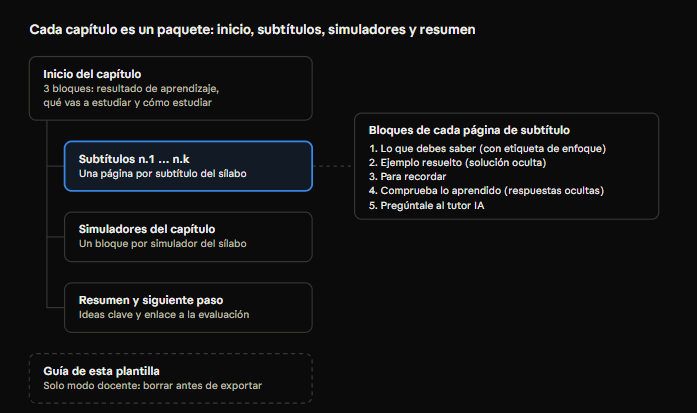

# Guía para estudiantes de vinculación: sílabo, plantilla eXeLearning y generación con IA

> **Fecha:** 15 nov 2026 · **Fuente:** [Artefacto original en Claude](https://claude.ai/artifact/SaKv3FZ6Qr1GU1UVqXriEq#42485266-b93d)

## Para qué sirve esta guía

Cada estudiante convierte los subtítulos que le asignó su docente en páginas de eXeLearning, con contenido generado con IA y verificado, siguiendo siempre la misma plantilla. Esta guía explica tres cosas: cómo leer el sílabo (**parte A**), cómo usar la plantilla de eXeLearning (**parte B**) y cómo pedir y verificar el contenido con IA (**parte C**).

### Material que recibe cada estudiante

| Archivo | Para qué sirve |
| :--- | :--- |
| **Sílabo de su materia (Word)** | Define capítulos, subtítulos, enfoque, destrezas y simuladores: es la única fuente de lo que va en el aula |
| **`Plantilla_Capitulo_ESPE.elpx`** | Proyecto de eXeLearning con el aspecto y la estructura de cada capítulo; el contenido `3.2` de Física está completo como modelo |
| **`Plantilla_Capitulo_ESPE_SCORM12.zip`** | La misma plantilla exportada, para ver cómo queda en Moodle |
| **Guía para crear las aulas virtuales en Moodle** | Cómo se arma el aula, el banco de preguntas y las evaluaciones |
| **Cronograma de vinculación** | Fechas, horas y la hoja *"Avance por capítulo"* donde se marca cada entrega |

**Regla de oro: el sílabo manda.** Si un tema no está en el sílabo, no va en el aula sin autorización del docente.

---

## Parte A. Cómo leer el sílabo

El sílabo está organizado por capítulos, y cada parte del capítulo alimenta una parte concreta del paquete de eXeLearning. Antes de pedir nada a la IA, ubique en el sílabo los datos de sus subtítulos:

| Parte del sílabo | Dónde está | Qué se hace con ella |
| :--- | :--- | :--- |
| **Resultado de aprendizaje del capítulo** | Fila bajo el título del capítulo | Se copia tal cual en el bloque *"Resultado de aprendizaje"* de la página de inicio |
| **Contenidos mínimos (`n.1`, `n.2`…)** | Columna izquierda de la tabla del capítulo | Cada subtítulo es una página del paquete, con el mismo número y el mismo nombre |
| **Tareas autónomas (`Tarea autónoma n.k`)** | Columna derecha, *"Autónomo (plataforma con IA)"* | Indican qué tipo de ejercicios piden los bloques *"Ejemplo resuelto"* y *"Comprueba lo aprendido"* |
| **Simuladores (`El estudiante` / `Reto`)** | Columna derecha, *"Práctico – experimental"* | Cada simulador es un bloque de la página *"Simuladores del capítulo"*, con las mismas instrucciones y el mismo reto |
| **Evaluación en línea `n`** | Al final de la columna práctica | Se arma en Moodle con el banco de preguntas (guía de aulas) |
| **Tabla *"Enfoque de los contenidos"*** | Debajo de cada capítulo | Dice el enfoque de cada subtítulo y sus destrezas del currículo; define cómo se pide el contenido a la IA |
| **Lineamientos para la generación con IA** | Sección final del sílabo | Reglas generales que esta guía desarrolla en la parte C |

> **Ejemplo con Física, capítulo 3:** el subtítulo `3.2 Movimiento rectilíneo uniforme (MRU)` tiene enfoque **Refuerzo** y las destrezas `CN.F.5.1.1`, `CN.F.5.1.3` y `CN.F.5.1.4`. En la plantilla, ese subtítulo ya está completo como modelo.

### El enfoque de cada contenido

El enfoque dice cuánto sabe ya el estudiante de colegio sobre ese subtítulo, y por eso cambia la profundidad del material. Sale de comparar el sílabo de nivelación de la ESPE con el Currículo Priorizado de Bachillerato 2025.

| Enfoque | Qué significa | Qué se pide a la IA | Etiqueta en eXeLearning |
| :--- | :--- | :--- | :--- |
| **Refuerzo** | El colegio ya lo enseña | Repaso breve (una pantalla), 2 ejemplos resueltos y ejercicios tipo examen de ingreso | Verde: `enfoque enf-refuerzo` |
| **Profundización** | El colegio lo enseña en parte | Completar lo que falta, de básico a avanzado, con 3 ejemplos resueltos | Amarilla: `enfoque enf-prof` |
| **Puente a la universidad** | El colegio no lo enseña | Explicar desde cero, empezando por los prerrequisitos, con ejemplos paso a paso antes de los ejercicios | Azul: `enfoque enf-puente` |

En Estadística y Probabilidad no hay sílabo de nivelación: los subtítulos salen del currículo y casi todos son *Refuerzo*; la correlación y la regresión son *Profundización*.

---

## Parte B. Estructura de la plantilla eXeLearning

Todos los capítulos de todas las materias tienen las mismas páginas y los mismos bloques, en el mismo orden, con el estilo **Universal** de eXeLearning. Así el estudiante de colegio aprende a moverse en un capítulo y ya sabe moverse en todos.



| Bloque de cada subtítulo | Qué contiene | De dónde sale |
| :--- | :--- | :--- |
| **1. Lo que debes saber** | Etiqueta de enfoque y explicación del subtítulo | Contenido mínimo + enfoque del sílabo; **instrucción 1** de la parte C |
| **2. Ejemplo resuelto** | 2 o 3 ejemplos; la solución queda en el botón *"Ver solución"* | Tarea autónoma del sílabo; **instrucción 2** |
| **3. Para recordar** | 3 a 5 viñetas con fórmulas e ideas clave | **Instrucción 3** |
| **4. Comprueba lo aprendido** | 3 preguntas cortas; respuestas en *"Ver respuestas"* | **Instrucción 4** |
| **5. Pregúntale al tutor IA** | 3 preguntas sugeridas para el tutor del capítulo en Moodle | **Instrucción 5** |

El modelo completo de todos los bloques es la página **`3.2 Movimiento rectilíneo uniforme (MRU)`** de la plantilla: antes de empezar, ábrala y úsela como referencia de extensión y tono.

### Cómo replicar la plantilla para un capítulo

Un capítulo es un solo proyecto de eXeLearning; cuando varios estudiantes comparten un capítulo, cada uno trabaja sus páginas y uno de ellos (el que el docente designe) las reúne en el archivo final.

1. **Copiar la plantilla.** Abrir `Plantilla_Capitulo_ESPE.elpx` en eXeLearning y guardarlo con el nombre del capítulo: `MAT_Cap01_Logica-y-conjuntos.elpx` (materia en 3 letras: `MAT`, `GEO`, `EST`, `FIS`, `QUI`, `BIO`).
2. **Propiedades del proyecto.** Cambiar el título (*"Física · Capítulo 3… (PLANTILLA)"*) por el de su materia y capítulo, y quitar la palabra `PLANTILLA`. No cambiar el estilo (`Universal`) ni desactivar MathJax.
3. **Página de inicio.** Cambiar el nombre al del capítulo del sílabo, pegar el resultado de aprendizaje y actualizar la tabla *"Qué vas a estudiar"* con sus subtítulos y su enfoque.
4. **Una página por subtítulo.** Dejar tantas subpáginas como subtítulos tenga el capítulo, con el número y el nombre exactos del sílabo (por ejemplo, `"1.3 Métodos de demostración: directo e indirecto"`). Borrar las que sobren y copiar la página modelo si faltan.
5. **Los cinco bloques.** En cada subpágina, reemplazar cada recuadro rojo `PLANTILLA` por el contenido generado y verificado (parte C). Mantener los nombres de los bloques y su orden.
6. **Etiqueta de enfoque.** Al inicio de *"Lo que debes saber"* va la etiqueta del enfoque. Para cambiarla, abrir el editor de código HTML del bloque y cambiar la clase (`enf-refuerzo`, `enf-prof` o `enf-puente`) y el texto:
   ```html
   <span class="enfoque enf-puente">Enfoque: Puente a la universidad</span>
   ```
7. **Fórmulas.** Escribirlas en LaTeX: `\( x = x_0 + v\,t \)` dentro del texto y `\[ … \]` en una línea aparte. **Nunca usar el signo `$`**. Revisar en la vista previa que se vean bien.
8. **Soluciones y respuestas.** Van siempre en la retroalimentación del bloque de Texto (botón *"Ver solución"* o *"Ver respuestas"*), nunca a la vista.
9. **Página de simuladores.** Un bloque por simulador del sílabo, con *"Qué haces"* y *"Reto"* copiados del sílabo. El simulador se inserta con el iDevice *Sitio web externo* (PhET, archivo HTML propio del paquete u otra página, con el crédito del autor debajo) o con el iDevice *GeoGebra*.
10. **Resumen y siguiente paso.** Completar las ideas clave del capítulo y cambiar el número de la evaluación en línea y del capítulo siguiente.
11. **Borrar la página *"Guía de esta plantilla"*** antes de exportar.
12. **Exportar.** Exportar como **SCORM 1.2** y entregar dos archivos: el `.elpx` (editable) y el `.zip` del SCORM. El SCORM se sube a Moodle como actividad SCORM.

Cada vez que termine un subtítulo, guardar el `.elpx` con fecha (`MAT_Cap01_2026-11-20.elpx`) en la carpeta compartida del grupo, para no perder trabajo.

---

## Parte C. Reglas para trabajar con IA

La IA redacta un primer borrador; el estudiante responde por lo que se publica. Estas reglas valen para cualquier herramienta (Claude, ChatGPT, Gemini u otra):

1. **Un subtítulo a la vez.** Nunca pedir un capítulo entero en una sola instrucción: el resultado es superficial y difícil de revisar.
2. **Dar el contexto del sílabo.** Toda instrucción incluye materia, capítulo, subtítulo, enfoque y destrezas (las plantillas de la sección siguiente ya lo piden).
3. **Verificar cada cálculo** con calculadora, GeoGebra, Python o una hoja de cálculo. La IA todavía se equivoca en aritmética, signos y unidades.
4. **Verificar cada concepto** con la bibliografía del sílabo. Si la IA y el libro no coinciden, manda el libro.
5. **No copiar textos, imágenes ni ejercicios** de libros o páginas sin citar al autor. Las imágenes deben ser propias, generadas para el proyecto o con licencia libre, siempre con su crédito.
6. **No subir datos personales** de estudiantes ni de los colegios a ninguna herramienta de IA.
7. **Contexto ecuatoriano.** Pedir ejemplos con situaciones de Ecuador, en español neutro y con unidades del Sistema Internacional (coma decimal en el texto: `3,6`).
8. **Guardar las instrucciones que funcionaron** en un documento del grupo, para que todos las reutilicen y el grupo 2 las herede.

---

### Instrucciones listas para copiar

Se pega primero el contexto (una vez por conversación con la IA) y después la instrucción de cada bloque, en el orden de la plantilla. Los corchetes se completan con los datos del sílabo.

#### 0. Contexto de la conversación

```text
Eres docente de [materia] y preparas material de refuerzo para estudiantes de tercero de Bachillerato de colegios fiscales de Quito (Ecuador) que se preparan para el examen de ingreso a la universidad.
Escribe en español, con oraciones cortas, ejemplos de la vida diaria en Ecuador y unidades del Sistema Internacional.
Escribe las fórmulas en LaTeX: \( ... \) dentro del texto y \[ ... \] en una línea aparte. No uses el signo $.
Capítulo: [n – título del capítulo]
Resultado de aprendizaje: [copiado del sílabo]
No incluyas temas fuera del subtítulo que te indique.
```

#### 1. Bloque «Lo que debes saber»

```text
Subtítulo: [n.k – texto exacto del sílabo]
Enfoque: [Refuerzo | Profundización | Puente a la universidad]
Destrezas del currículo: [códigos de la tabla de enfoque]
Escribe la explicación del subtítulo según el enfoque:
- Refuerzo: repaso breve de máximo 250 palabras.
- Profundización: explicación completa de básico a avanzado, máximo 450 palabras.
- Puente a la universidad: empieza por los prerrequisitos y explica desde cero, máximo 600 palabras.
Termina con una lista de 3 a 5 puntos clave.
```

#### 2. Bloque «Ejemplo resuelto»

```text
Para el subtítulo [n.k], escribe [2 | 3] ejemplos resueltos paso a paso, de dificultad creciente; el último debe ser tipo examen de ingreso a la universidad.
Para cada ejemplo da por separado: ENUNCIADO y SOLUCIÓN (con cada paso justificado y la respuesta final con unidades).
Toma como guía esta tarea del sílabo: [Tarea autónoma n.k].
```

#### 3. Bloque «Para recordar»

```text
Resume el subtítulo [n.k] en 3 a 5 viñetas cortas con las fórmulas y las ideas que un estudiante debe memorizar para el examen de ingreso.
```

#### 4. Bloque «Comprueba lo aprendido»

```text
Escribe 3 preguntas cortas para que el estudiante compruebe si entendió el subtítulo [n.k]: una conceptual, una de cálculo sencillo y una de aplicación.
Da por separado: PREGUNTAS y RESPUESTAS (con el resultado y una línea de justificación).
```

#### 5. Bloque «Pregúntale al tutor IA»

```text
Propón 3 preguntas que un estudiante podría hacerle a un tutor de IA sobre el subtítulo [n.k] para entenderlo mejor: una para pedir otro ejemplo, una para practicar con corrección y una de "por qué".
```

#### 6. Banco de preguntas del subtítulo (formato Aiken)

```text
Genera [6 | 10] preguntas de opción múltiple sobre el subtítulo [n.k], nivel [básico | intermedio | examen de ingreso], en formato Aiken de Moodle:
- enunciado en una sola línea (las fórmulas en \( ... \)),
- 4 opciones que empiecen con A) B) C) D),
- una línea ANSWER: con la letra correcta,
- una línea en blanco entre preguntas.
Los distractores deben corresponder a errores frecuentes de los estudiantes.
Después del bloque Aiken, y por separado, da la solución de cada pregunta para que el docente la revise.
```

#### 7. Preguntas de reto del simulador

```text
El simulador del capítulo es: [nombre del simulador del sílabo]. El estudiante: [texto "El estudiante" del sílabo]. Reto: [texto "Reto" del sílabo].
Escribe 3 preguntas que el estudiante responda prediciendo primero y comprobando después con el simulador. Indica qué valores debe poner en el simulador y la respuesta esperada, con una explicación de qué observar si se equivoca.
```

#### 8. Página «Resumen y siguiente paso» (Ideas clave del capítulo)

```text
Con los subtítulos [lista n.1 a n.k], escribe las ideas clave del capítulo en 5 a 8 viñetas, una por subtítulo como mínimo.
```

#### 9. Prueba diagnóstica (pretest de toda la materia)

```text
Genera 3 preguntas de opción múltiple en formato Aiken por cada capítulo de esta lista: [capítulos y subtítulos del sílabo].
Nivel: lo que debería saber un estudiante al terminar el Bachillerato. Una pregunta fácil, una media y una difícil por capítulo.
Indica a qué capítulo y subtítulo corresponde cada pregunta y da las soluciones por separado.
```

---

## Verificación antes de entregar

Ningún subtítulo se marca como listo en la hoja *"Avance por capítulo"* sin pasar esta lista:

- [ ] El número y el nombre del subtítulo son los del sílabo.
- [ ] La etiqueta de enfoque es la de la tabla de enfoque del sílabo.
- [ ] Están los cinco bloques, en orden, sin ningún recuadro `PLANTILLA`.
- [ ] Cada cálculo de los ejemplos y de las respuestas fue comprobado con software.
- [ ] Los conceptos coinciden con la bibliografía del sílabo.
- [ ] Las fórmulas se ven bien en la vista previa, en computadora y en celular.
- [ ] Las soluciones están dentro del botón de retroalimentación.
- [ ] Las preguntas del banco tienen una sola respuesta correcta y su solución revisada.
- [ ] Las imágenes y simuladores externos tienen el crédito del autor.

### Errores frecuentes de la IA y cómo detectarlos

| Error | Cómo detectarlo |
| :--- | :--- |
| **Aritmética o signos equivocados** | Rehacer cada cálculo con software; desconfiar de resultados *"redondos"* que no cuadran |
| **Unidades mezcladas o ausentes** | Revisar que cada resultado tenga unidad y que el análisis dimensional cierre |
| **Más de una opción correcta en una pregunta** | Resolver la pregunta sin mirar la clave |
| **Temas fuera del subtítulo o del nivel** | Compararlo con los contenidos mínimos del sílabo |
| **Definiciones distintas a las del libro de la materia** | Comparar con la bibliografía del sílabo; manda el libro |
| **Fórmulas con `$` o mal cerradas** | Vista previa de eXeLearning: si la fórmula no se dibuja, está mal escrita |
| **Datos inventados (fechas, cifras, nombres)** | Quitar cualquier dato que no se pueda comprobar en una fuente |
